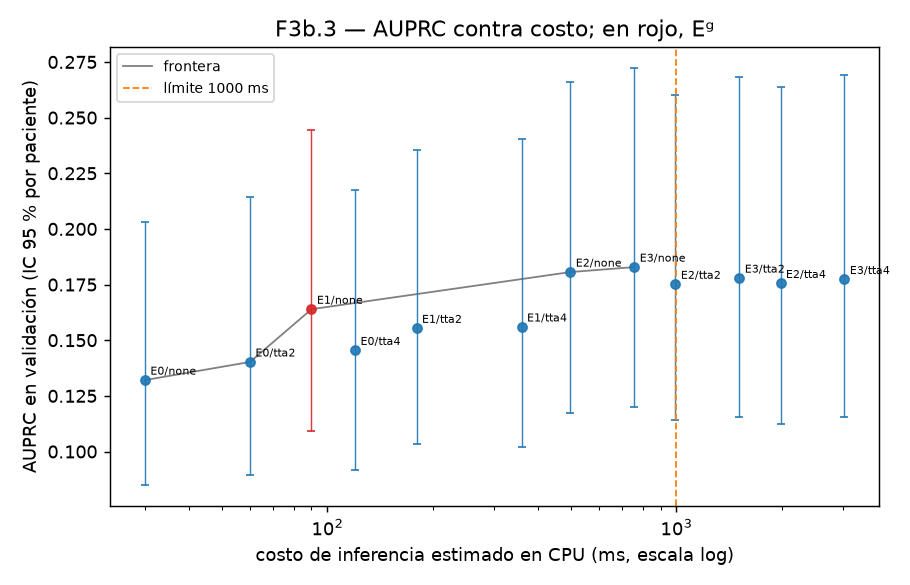

# F3b — Ensamble, TTA y metadatos sobre validación

Generado por `scripts/f3b_report.py` el 2026-10-23 (commit `bf7cdee`) a partir de `reports/f3b_ensemble.json`. Todo se decidió sobre validación; el split de prueba no se tocó. Spec: `docs/specs/F3b-F4b.md`.

## 1. Verificación de los nueve checkpoints contra F3

Checkpoints bajados de las salidas de los kernels de F3 en Kaggle a `data/models/` (fuera de git) y evaluados sobre validación en CPU (4,963 imágenes, 88 melanomas, 568 pacientes). Criterio: |ΔAUC-ROC| < 0.005 respecto al `metrics.json` de la corrida (los valores que promedia `reports/f3_matrix.md`).

| corrida | archivo | SHA256 | MB | AUC-ROC corrida | AUC-ROC local | Δ | usado |
|:--|:--|:--|--:|--:|--:|--:|:--|
| a1-s0 | `tf_efficientnetv2_s-224-s0-e153979-04-0.0000.ckpt` | `e0ecf981adaa125d…` | 243.4 | 0.8335 | 0.8336 | +0.0001 | sí |
| a1-s1 | `tf_efficientnetv2_s-224-s1-e153979-08-0.0000.ckpt` | `cb96ff24b1b456c8…` | 243.4 | 0.8242 | 0.8243 | +0.0001 | sí |
| a1-s2 | `tf_efficientnetv2_s-224-s2-e153979-12-0.0000.ckpt` | `a59b6ad1c174d78b…` | 243.4 | 0.8178 | 0.8177 | -0.0001 | sí |
| m1-s0 | `tf_efficientnetv2_s-384-s0-d294744-12-0.0000.ckpt` | `5636d42dd0a77474…` | 243.4 | 0.8379 | 0.8378 | -0.0001 | sí |
| m1-s1 | `tf_efficientnetv2_s-384-s1-e153979-11-0.0000.ckpt` | `73a6e0e528c84793…` | 243.4 | 0.8096 | 0.8096 | -0.0000 | sí |
| m1-s2 | `tf_efficientnetv2_s-384-s2-e153979-05-0.0000.ckpt` | `3f0c1e18dd7cc52c…` | 243.4 | 0.8406 | 0.8406 | -0.0000 | sí |
| m2-s0 | `convnext_tiny-384-s0-e153979-11-0.0000.ckpt` | `2ea49a513b0641ad…` | 334.1 | 0.8404 | 0.8405 | +0.0001 | sí |
| m2-s1 | `convnext_tiny-384-s1-e153979-12-0.0000.ckpt` | `0040e8f5ec8649e9…` | 334.1 | 0.8316 | 0.8317 | +0.0001 | sí |
| m2-s2 | `convnext_tiny-384-s2-e153979-09-0.0000.ckpt` | `ff2a189bfe8e28b8…` | 334.1 | 0.8283 | 0.8283 | +0.0001 | sí |

9/9 checkpoints reproducen su AUC; excluidos: ninguno. Logits en caché: `reports/predictions/f3b_val_logits.npz` (SHA256 `0751612439121ee9…`), forma [9, 4, 4963], vistas identity, hflip, vflip, hvflip.

## 2. Las combinaciones: ensamble × TTA

Ensamble = promedio de **logits**. Costo = GFLOPs por imagen × vistas; latencia extrapolada de F6 (2.9 GFLOPs ≈ 30 ms de ONNX en la laptop). IC 95 % por bootstrap a nivel paciente (2,000 remuestreos). Ordenadas por AUPRC; **Eᵍ en negritas**; las que violan el límite de 1000 ms quedan tachadas.

| combinación | modelos | vistas | AUC-ROC | AUPRC | spec@sens0.90 | spec@sens0.95 | GFLOPs | ≈ ms | factible |
|:--|:--|:--|:--|:--|:--|:--|--:|--:|:--|
| E3/none | A1 ×3 + M1 ×3 + M2 ×3 | 1 | 0.858 [0.814, 0.898] | 0.183 [0.120, 0.272] | 0.580 [0.429, 0.689] | 0.432 [0.178, 0.605] | 73.2 | 757 | sí |
| E2/none | A1 ×3 + M2 ×3 | 1 | 0.854 [0.809, 0.895] | 0.181 [0.117, 0.266] | 0.581 [0.450, 0.706] | 0.464 [0.180, 0.609] | 48.0 | 497 | sí |
| ~~E3/tta2~~ | A1 ×3 + M1 ×3 + M2 ×3 | 2 | 0.857 [0.813, 0.897] | 0.178 [0.116, 0.268] | 0.585 [0.405, 0.682] | 0.407 [0.182, 0.608] | 146.4 | 1514 | no |
| ~~E3/tta4~~ | A1 ×3 + M1 ×3 + M2 ×3 | 4 | 0.857 [0.813, 0.898] | 0.177 [0.116, 0.269] | 0.586 [0.394, 0.701] | 0.396 [0.186, 0.605] | 292.8 | 3029 | no |
| ~~E2/tta4~~ | A1 ×3 + M2 ×3 | 4 | 0.854 [0.809, 0.894] | 0.176 [0.113, 0.264] | 0.581 [0.411, 0.705] | 0.414 [0.218, 0.601] | 192.0 | 1986 | no |
| E2/tta2 | A1 ×3 + M2 ×3 | 2 | 0.854 [0.808, 0.894] | 0.175 [0.114, 0.260] | 0.594 [0.417, 0.697] | 0.422 [0.185, 0.620] | 96.0 | 993 | sí |
| **E1/none** | A1 ×3 | 1 | 0.847 [0.799, 0.889] | 0.164 [0.109, 0.244] | 0.524 [0.360, 0.718] | 0.371 [0.137, 0.572] | 8.7 | 90 | sí |
| E1/tta4 | A1 ×3 | 4 | 0.845 [0.798, 0.888] | 0.156 [0.102, 0.240] | 0.545 [0.343, 0.700] | 0.353 [0.099, 0.563] | 34.8 | 360 | sí |
| E1/tta2 | A1 ×3 | 2 | 0.845 [0.797, 0.888] | 0.155 [0.103, 0.236] | 0.498 [0.395, 0.689] | 0.401 [0.155, 0.567] | 17.4 | 180 | sí |
| E0/tta4 | A1 semilla 0 (referencia, modelo de F4) | 4 | 0.834 [0.785, 0.877] | 0.145 [0.091, 0.218] | 0.474 [0.330, 0.692] | 0.335 [0.106, 0.582] | 11.6 | 120 | sí |
| E0/tta2 | A1 semilla 0 (referencia, modelo de F4) | 2 | 0.833 [0.784, 0.875] | 0.140 [0.089, 0.214] | 0.509 [0.343, 0.704] | 0.340 [0.033, 0.555] | 5.8 | 60 | sí |
| E0/none (ref.) | A1 semilla 0 (referencia, modelo de F4) | 1 | 0.834 [0.786, 0.875] | 0.132 [0.085, 0.203] | 0.525 [0.395, 0.672] | 0.400 [0.069, 0.550] | 2.9 | 30 | sí |

### Regla de decisión aplicada (escrita antes de ver los números)

1. Orden por AUPRC y después por spec@sens0.90: líder **E3/none**.
2. Empate (|ΔAUC-ROC| y |ΔAUPRC| < 0.02) con el líder: E3/none, E2/none, E2/tta2, E1/none; el más barato de ellos es E1/none.
3. Restricción dura (< 1000 ms estimados): fuera E2/tta4, E3/tta2, E3/tta4.
4. Empatados, factibles y que superan a E0/none por más de 0.02 de AUPRC: E3/none, E2/none, E2/tta2, E1/none (mejor ganancia entre todas las factibles: +0.0508). **El ensamble aporta.** Eᵍ = **E1/none** (A1 ×3, 1 vista(s)): AUPRC 0.164 contra 0.132 de la referencia (+0.032), AUC-ROC 0.847 contra 0.834, spec@sens0.95 0.371 contra 0.400; costo 8.7 GFLOPs ≈ 90 ms.

## 3. AUPRC contra costo

Frontera: ninguna combinación es a la vez más barata y mejor que las de la línea. La línea punteada es el límite de latencia.

## 4. Metadatos apilados

Regresión logística L2 sobre el logit de Eᵍ más age_approx (estandarizada, con indicador de faltante) y sex, anatom_site (one-hot con faltante). C elegido por VC interna agrupada por paciente (5 pliegues, `neg_log_loss`, C ∈ [0.01, 0.03, 0.1, 0.3, 1.0, 3.0, 10.0]); evaluación por VC externa de 5 pliegues agrupada por paciente, comparando las predicciones fuera de pliegue del apilador con Eᵍ solo sobre las mismas imágenes.

| | AUC-ROC | AUPRC | spec@sens0.95 |
|:--|:--|:--|:--|
| Eᵍ solo | 0.847 [0.799, 0.889] | 0.164 [0.109, 0.244] | 0.371 [0.137, 0.572] |
| Eᵍ + metadatos (fuera de pliegue) | 0.839 [0.788, 0.884] | 0.156 [0.105, 0.243] | 0.231 [0.100, 0.542] |
| ganancia | -0.0081 | -0.0078 | -0.1401 |

| pliegue | n | melanomas | AUC Eᵍ | AUC apilador | spec@95 Eᵍ | spec@95 apilador | C |
|--:|--:|--:|--:|--:|--:|--:|--:|
| 0 | 1103 | 24 | 0.817 | 0.815 | 0.315 | 0.260 | 0.03 |
| 1 | 987 | 18 | 0.773 | 0.763 | 0.024 | 0.095 | 0.03 |
| 2 | 828 | 13 | 0.849 | 0.851 | 0.438 | 0.472 | 0.03 |
| 3 | 1004 | 17 | 0.912 | 0.915 | 0.359 | 0.334 | 0.03 |
| 4 | 1041 | 16 | 0.905 | 0.906 | 0.669 | 0.608 | 0.03 |

### Decisión

**No se despliegan**: la ganancia medida (ΔAUC-ROC -0.008, Δspec@sens0.95 -0.140) no alcanza el umbral (≥ +0.02 en AUC-ROC o ≥ +0.05 en spec@sens0.95). El modelo final de F3b es Eᵍ solo y la interfaz no pide metadatos.

## 5. Calibración y umbrales del modelo final de F3b

Modelo: **E1/none**. Platt sobre el logit del ensamble: a = 0.4473, b = -3.3553. Brier 0.0898 → 0.0161; ECE (10 bins uniformes) 0.1288 → 0.0022.

| umbral | τ (mediana) | p5 | p95 | corte único | sens | spec | VPP | VPN |
|:--|--:|--:|--:|--:|--:|--:|--:|--:|
| τ95 (sens ≥ 0.95) | 0.00385 | 0.00259 | 0.00534 | 0.00385 | 0.955 | 0.371 | 0.027 | 0.9978 |
| τ90 (sens ≥ 0.90) | 0.00560 | 0.00387 | 0.01071 | 0.00534 | 0.898 | 0.538 | 0.034 | 0.9966 |

Sobre validación con Platt: AUC-ROC 0.847 [0.799, 0.889], AUPRC 0.164 [0.109, 0.244], spec@sens0.95 0.371 [0.137, 0.572]. Bootstrap por paciente, 2,000 remuestreos, semilla 20260904.

> **Advertencia de optimismo.** Validación ya se usó para elegir Eᵍ, ajustar el apilador, calibrar y fijar el umbral. Su optimismo es mayor que en F4. El test es la única estimación limpia, y por eso existe F4b.

## 6. Declaración del modelo final de F3b

- Combinación: **E1/none** — A1 ×3; ensamble por promedio de logits; vistas de TTA: identity; costo 8.7 GFLOPs ≈ 90 ms.
- Apilador de metadatos: no.
- Platt a = 0.447265, b = -3.355278; τ95 = 0.003851; τ90 = 0.005600.
- Logits de validación: `reports/predictions/f3b_val_logits.npz`, SHA256 `0751612439121ee92ef03e7e3e0c20ecf36d7ca72df3ff03184b24ac2c6a86a1`.
- Protocolo de F4b: `docs/f4b_protocol.yaml` (escrito desde estos valores).

| miembro | archivo | SHA256 |
|:--|:--|:--|
| a1-s0 | `tf_efficientnetv2_s-224-s0-e153979-04-0.0000.ckpt` | `e0ecf981adaa125dd707d2e5e3b75cff003335e56aaa7356fca9e961d4710040` |
| a1-s1 | `tf_efficientnetv2_s-224-s1-e153979-08-0.0000.ckpt` | `cb96ff24b1b456c81c220c4cc90db291ec8b15d2e357cb3298b60a3680f0f3a6` |
| a1-s2 | `tf_efficientnetv2_s-224-s2-e153979-12-0.0000.ckpt` | `a59b6ad1c174d78b7c7218e1e737e3fd8c3b139ff05909ce7aa9980ef98a1340` |
