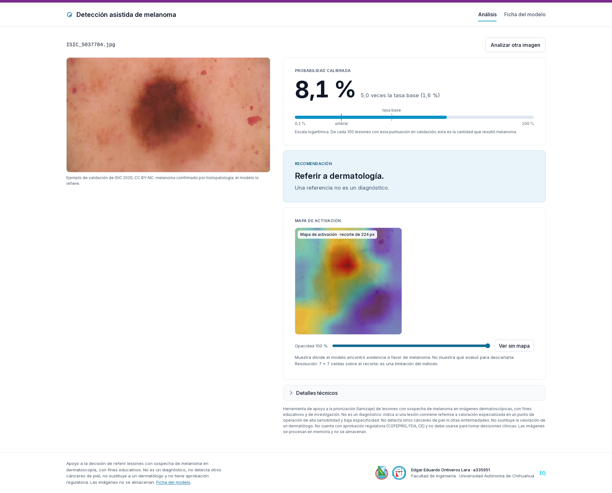
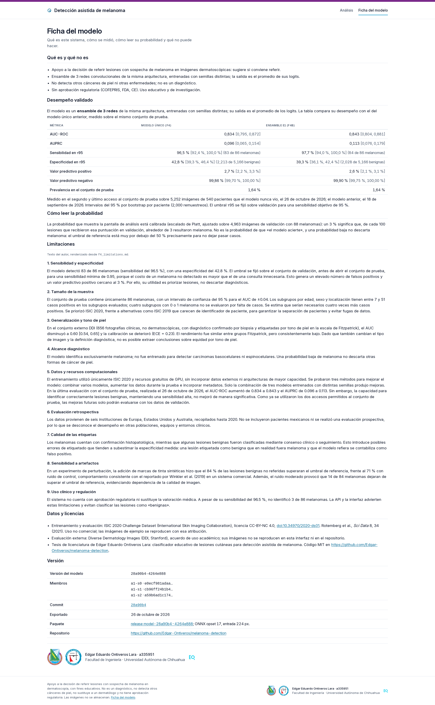

# F7b — Sistema visual: contraste y capturas

Generado por `scripts/f7b_visual.py` el 2026-10-27 desde `services/web/src/styles/tokens.css`. Contraste según WCAG 2.1 (AA: ≥ 4.5:1 para texto normal, ≥ 3:1 para texto ≥ 24 px).

## Contraste de los tokens

| texto | fondo | uso | razón | mínimo | cumple |
|:--|:--|:--|--:|--:|:--|
| `--text` #0f172a | `--bg` #ffffff | cuerpo, títulos, tablas | 17.85:1 | 4.5:1 | sí |
| `--text` #0f172a | `--surface` #f8fafc | zona de carga, detalles, pie, recomendación bajo el umbral | 17.06:1 | 4.5:1 | sí |
| `--text-2` #475569 | `--bg` #ffffff | subtítulos, etiquetas, ayuda, intervalos | 7.58:1 | 4.5:1 | sí |
| `--text-2` #475569 | `--surface` #f8fafc | ayuda en tarjetas con superficie, pie | 7.24:1 | 4.5:1 | sí |
| `--accent` #0b6e99 | `--bg` #ffffff | enlaces, botón fantasma, subrayado activo | 5.67:1 | 4.5:1 | sí |
| `--accent-hover` #085578 | `--bg` #ffffff | enlaces al pasar | 8.14:1 | 4.5:1 | sí |
| `--on-accent` #ffffff | `--accent` #0b6e99 | botón primario | 5.67:1 | 4.5:1 | sí |
| `--on-accent` #ffffff | `--accent-hover` #085578 | botón primario al pasar | 8.14:1 | 4.5:1 | sí |
| `--accent-hover` #085578 | `--accent-tint` #e8f4fa | etiqueta «Recomendación» sobre el tinte | 7.27:1 | 4.5:1 | sí |
| `--accent` #0b6e99 | `--accent-tint` #e8f4fa | enlaces y acento sobre el tinte | 5.06:1 | 4.5:1 | sí |
| `--text` #0f172a | `--accent-tint` #e8f4fa | texto de la recomendación por encima del umbral | 15.94:1 | 4.5:1 | sí |
| `--text-2` #475569 | `--accent-tint` #e8f4fa | segunda línea de la recomendación | 6.77:1 | 4.5:1 | sí |
| `--text` #0f172a | `--bg` #ffffff | probabilidad a 52/64/72 px | 17.85:1 | 3.0:1 | sí |
| `--accent` #0b6e99 | `--accent-tint` #e8f4fa | icono de subir en el círculo de la zona de carga | 5.06:1 | 4.5:1 | sí |

**Todos los pares cumplen AA.** Los bordes (`--border`, `--border-strong`) no llevan texto; el anillo de foco es `--accent` sobre `--bg` con 2 px de separación.

## Capturas

Tomadas con `make f7-screenshots` (Playwright, Chromium) contra la demo local, a 1920 px (escritorio) y 390 px (teléfono): análisis vacío y con resultado, ficha del modelo y aviso.

- `reports/figures/f7_ui_analisis_resultado_1920.png`
- `reports/figures/f7_ui_analisis_resultado_390.png`
- `reports/figures/f7_ui_analisis_vacio_1920.png`
- `reports/figures/f7_ui_analisis_vacio_390.png`
- `reports/figures/f7_ui_aviso_1920.png`
- `reports/figures/f7_ui_aviso_390.png`
- `reports/figures/f7_ui_modelo_1920.png`
- `reports/figures/f7_ui_modelo_390.png`

